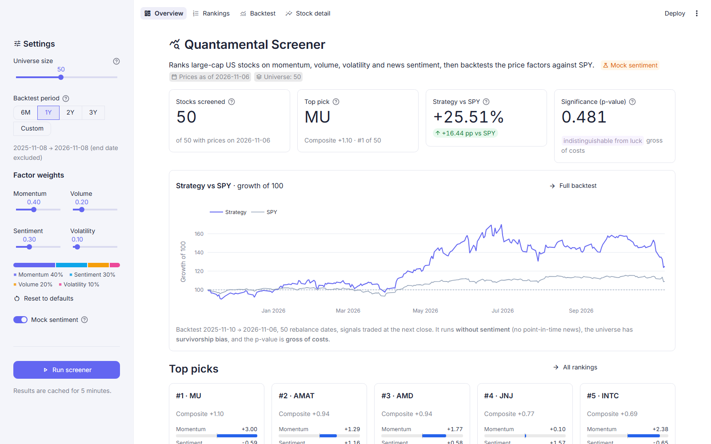

# Quantamental Screener

Ranks large-cap US stocks on a weighted mix of price momentum, volume, volatility and news sentiment, then backtests the ranking against an equal-weight portfolio of the same universe and SPY, with a significance test so you can tell skill from luck.


[](https://github.com/akshayaa-403/quantamental-screener/actions/workflows/ci.yml)
[](https://quantamental-screener.streamlit.app)

**[Try the live dashboard →](https://quantamental-screener.streamlit.app)** (the free host sleeps when idle, so the first load can take up to a minute)

<picture>
  <source media="(prefers-color-scheme: dark)" srcset="docs/screenshot-dark.png">
  
</picture>

## What it does

1. **Picks a universe.** It takes the current S&P 500, keeps names above a market-cap and average-dollar-volume floor, and keeps the largest *N* by market cap.
2. **Scores every stock on four factors.** Each factor is z-scored across the day's universe and clipped to ±3, then combined using weights you set.
3. **Ranks them**, in a terminal report from the CLI or in an interactive Streamlit dashboard.
4. **Backtests the ranking.** It holds the top *N* at equal weight, rebalances every *k* days, charges transaction costs and compares the result with an equal-weight portfolio of the whole universe and with SPY.

## The factors

| Factor | Definition | Why |
|---|---|---|
| **Momentum** | 12-minus-1: return from 12 months ago to 1 month ago | Skips the latest month because one-month returns tend to reverse |
| **Volume** | 10-day average of (volume ÷ 20-day average volume) × sign of the day's return | Sustained buying ranks high and sustained selling ranks low. Raw volume can't tell them apart, and a single day is mostly noise |
| **Volatility** | *Negative* annualised 60-day volatility | Favours the more stable names (the low-volatility anomaly). Shorter windows are noisy and churn the portfolio |
| **Sentiment** | VADER (with a finance word list) + TextBlob sentiment of up to 10 headlines from the last 7 days, shrunk toward neutral by *n* / (*n* + 3) for *n* headlines. NewsAPI is searched for the company name in titles; Yahoo Finance's news for the ticker is the fallback | Adds the "fundamental" news view to the price signals. Live ranking only (see below) |

Default weights are 0.4 / 0.2 / 0.1 / 0.3 (momentum / volume / volatility / sentiment). In the dashboard you set them with sliders, and they are renormalised to sum to 100%.

## Dashboard

Pick the settings in the sidebar: universe size, a period preset (6M, 1Y, 2Y, 3Y or a custom range), the four factor weights and the sentiment source. Then click **Run screener**. Nothing reruns until you do. If you change a setting afterwards, a notice says the results on screen come from the previous run. On a first visit, **Run demo** runs the default settings with mock sentiment in one click. A status panel shows each stage as it runs (universe, prices, news, scoring, backtest).

The app has four pages:

- **Overview**: headline numbers (stocks screened, top pick, strategy vs SPY, significance), a small equity curve and cards for the top five picks
- **Rankings**: the ranked table with color-coded factor z-scores, ticker search, a top-N switch and CSV download, plus the composite distribution and the factor correlation heatmap
- **Backtest**: return, SPY return, excess return and Sharpe; drawdown, volatility, hit rate, turnover and costs; the p-value with a plain-English reading; the equity curve with a drawdown chart below it; and the caveats that come with it
- **Stock detail**: one ticker's rank and percentile, its factor z-scores against the universe median, price and volume, and its sentiment with recent headlines

A toggle swaps real news for seeded mock sentiment, which gives a fast, deterministic demo. With real news, every name in the universe is searched (in parallel). Names with no headlines in the last week show a blank sentiment cell and count as neutral (a z-score of 0) in the composite. The Rankings table also shows a **Price-only rank**: the ranking without sentiment, which is what the backtest tests.

## Quick start

```bash
git clone https://github.com/akshayaa-403/quantamental-screener.git
cd quantamental-screener
python -m venv venv && source venv/bin/activate   # Windows: venv\Scripts\activate
pip install -r requirements.txt
cp .env.example .env                               # every setting is optional

streamlit run streamlit_app.py                     # dashboard at http://localhost:8501
python app.py --top-n 10                           # or the CLI report
```

`pip install -e .` also installs the CLI as a `quantamental` command.

### With Docker

```bash
docker-compose up -d       # Streamlit on :8501 + Redis, caching enabled
```

### Redis caching (optional)

Price downloads and headlines are cached in Redis, which makes repeat runs much faster. Values are stored as Parquet or JSON, never pickled, so a shared Redis can't inject code. Caching is **off by default**. To use it outside Docker:

```bash
docker-compose up -d redis
# then in .env:  REDIS_ENABLED=true
python scripts/clear_redis_cache.py   # wipe the cache when needed
```

## Configuration

Everything is set through environment variables or `.env`. See [.env.example](.env.example) for the full annotated list.

| Prefix | Controls |
|---|---|
| `UNIVERSE_*` | Universe size, minimum market cap, minimum average dollar volume |
| `FACTOR_*` | Factor weights |
| `BACKTEST_*` | Period, rebalance frequency, top N, risk-free rate (default: daily T-bill yield), cost in bps, bootstrap draws, holdout share |
| `SENTIMENT_*` | News lookback days, headlines per name, shrinkage prior |
| `REDIS_*` | Enable flag, URL, TTLs |
| `NEWS_API_KEY` | [NewsAPI](https://newsapi.org) key for headlines. Without it, falls back to yfinance news |
| `USE_MOCK_SENTIMENT` | `true` for seeded mock sentiment (offline demo) |

## How the backtest works (and what it can't tell you)

- **No lookahead.** Scores on day *t* use data up to the close of *t*, and the portfolio trades on them at the close of *t+1*. Tests in `tests/test_pipeline.py` change future prices and check that past scores and past equity don't move.
- **No sentiment.** News sentiment is a snapshot of today's headlines, so it only feeds the live ranking. Applying it to past dates would be lookahead.
- **Warm-up.** Factors are `NaN` until they have enough history (momentum needs about 13 months). About 400 extra calendar days are downloaded before the window, so trading starts on day one.
- **Equal weight, costs and turnover.** Each rebalance resets the portfolio to 1/*N* per name, and every trade that takes (new names, exits and the trims and top-ups of held names) pays `BACKTEST_TRANSACTION_COST_BPS` out of the portfolio.
- **Significance.** `p_value` is the share of random portfolios, drawn from the same eligible names at each rebalance, that matched the strategy's picks (gross of costs). The strategy is equal-weighted per period, so it is exactly what the random portfolios are compared with. A year of weekly rebalancing is about 50 decisions. Treat a large p-value as "indistinguishable from luck".
- **Survivorship and size bias remain.** The universe is *today's* S&P 500, ranked by *today's* market cap: every name is a company that grew large, and none has since dropped out of the index. Any portfolio of them tends to beat SPY in hindsight, so the gap to SPY flatters the strategy. Two things correct for it: the **equal-weight universe** benchmark (every eligible name, same rebalance dates, gross of costs) shares the bias, so `excess_vs_universe` isolates the stock selection, and the p-value draws from the same names. A clean fix needs point-in-time constituent lists. The backtest's own liquidity screen (trailing 20-day dollar volume, known the day before) is point-in-time.
- **Sharpe ratio.** Uses the daily 13-week T-bill yield (`^IRX`) as the risk-free rate unless `BACKTEST_RISK_FREE_RATE` fixes one. If the download fails, the result says so and uses 0%.
- **Overfitting.** The last `BACKTEST_HOLDOUT_FRACTION` (30%) of the window is reported separately as a holdout. Tune weights while looking at the earlier part only, then check them on the holdout. `BacktestEngine.run(..., start_date=..., end_date=...)` also restricts the trading window while still using earlier data for warm-up, for testing on a different period.

## Project layout

```
config/         pydantic-settings config (env vars / .env)
core/           Factor and SentimentModel base classes, Redis cache client
data_sources/   yfinance prices + NewsAPI/yfinance headlines
factors/        momentum, volume, volatility, sentiment
sentiment/      VADER, TextBlob, optional FinBERT, weighted ensemble
pipeline/       universe selection → data collection → scoring → backtest
output/         console report for the CLI
app.py          CLI entry point
streamlit_app.py  dashboard entry point (theme in .streamlit/config.toml)
ui/             dashboard pages, cached pipeline stages, chart helpers
tests/          pytest suite (network-free, uses fakeredis)
```

To add a factor, subclass `core.Factor` and implement `compute(data) -> pd.Series`, indexed by `(Ticker, Date)`, then pass it to `ScoringEngine` with a weight. Standardisation and ranking are handled for you.

## Development

```bash
pip install -r requirements-dev.txt
pytest
```

CI runs the suite on Python 3.10 and 3.11 on every push and pull request ([ci.yml](.github/workflows/ci.yml)). A second workflow ([wake.yml](.github/workflows/wake.yml)) opens the hosted demo every 6 hours so it doesn't go to sleep.

## Optional: FinBERT sentiment

VADER and TextBlob are lightweight lexicon models with nothing to download, which keeps the hosted app within Streamlit Community Cloud's ~1 GB memory limit. **FinBERT** is more accurate on financial text but adds `transformers` + `torch` and several hundred MB of memory, so use it only for local runs:

```bash
pip install -r requirements.txt -r requirements-finbert.txt
```

```python
from sentiment import FinBERTModel, VADERModel, TextBlobModel, EnsembleSentiment
sentiment_model = EnsembleSentiment(
    models=[FinBERTModel, VADERModel, TextBlobModel],
    weights=[0.5, 0.3, 0.2],
)
```

## Disclaimer

This is a research and learning project, not investment advice.

## License

MIT. See [LICENSE](LICENSE).
