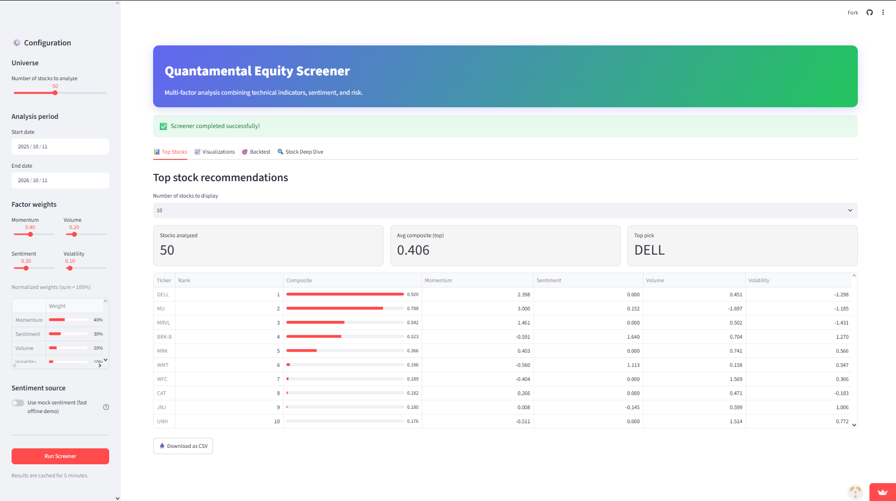

# Quantamental Screener

Ranks large-cap US stocks on a weighted mix of price momentum, volume, volatility and news sentiment, then backtests the ranking against SPY, with a significance test so you can tell skill from luck.


[](https://github.com/akshayaa-403/quantamental-screener/actions/workflows/ci.yml)
[](https://quantamental-screener.streamlit.app)

**[Try the live dashboard →](https://quantamental-screener.streamlit.app)** (the free host sleeps when idle, so the first load can take up to a minute)

<picture>
  <source media="(prefers-color-scheme: dark)" srcset="docs/screenshot-dark.png">
  
</picture>

## What it does

1. **Picks a universe.** It takes the current S&P 500, keeps names above a market-cap and average-volume floor, and keeps the largest *N* by market cap.
2. **Scores every stock on four factors.** Each factor is z-scored across the day's universe and clipped to ±3, then combined using weights you set.
3. **Ranks them**, in a terminal report from the CLI or in an interactive Streamlit dashboard.
4. **Backtests the ranking.** It holds the top *N*, rebalances every *k* days, charges transaction costs and compares the result with SPY.

## The factors

| Factor | Definition | Why |
|---|---|---|
| **Momentum** | 12-minus-1: return from 12 months ago to 1 month ago | Skips the latest month because one-month returns tend to reverse |
| **Volume** | Volume ÷ 20-day average volume, signed by the day's return | Heavy buying ranks high and heavy selling ranks low. Raw volume can't tell them apart |
| **Volatility** | *Negative* annualised 20-day volatility | Favours the more stable names (the low-volatility anomaly) |
| **Sentiment** | Average sentiment of the last 7 days of headlines, from VADER and TextBlob | Adds the "fundamental" news view to the price signals. Live ranking only (see below) |

Default weights are 0.4 / 0.2 / 0.1 / 0.3 (momentum / volume / volatility / sentiment). In the dashboard you set them with sliders, and they are renormalised to sum to 100%.

## Dashboard

The Streamlit app has four tabs:

- **Top Stocks**: the ranked table with each factor's z-score
- **Visualizations**: composite-score distribution, factor breakdown of the top picks, and a factor correlation heatmap
- **Backtest**: equity curve against SPY, plus return, Sharpe, max drawdown, volatility, hit rate, turnover, costs and the p-value
- **Stock Deep Dive**: factor scores, sentiment, price chart and last week's headlines for any single ticker

A toggle swaps real news for seeded mock sentiment, which gives a fast, deterministic demo that works offline. To keep news calls fast, the dashboard fetches real sentiment only for the top 20 tickers by market cap and scores the rest as neutral.

## Quick start

```bash
git clone https://github.com/akshayaa-403/quantamental-screener.git
cd quantamental-screener
python -m venv venv && source venv/bin/activate   # Windows: venv\Scripts\activate
pip install -r requirements.txt
cp .env.example .env                               # every setting is optional

streamlit run streamlit_app.py                     # dashboard at http://localhost:8501
python app.py --top-n 10                           # or the CLI report
```

`pip install -e .` also installs the CLI as a `quantamental` command.

### With Docker

```bash
docker-compose up -d       # Streamlit on :8501 + Redis, caching enabled
```

### Redis caching (optional)

Price and fundamentals downloads are cached in Redis, which makes repeat runs much faster. Caching is **off by default**. To use it outside Docker:

```bash
docker-compose up -d redis
# then in .env:  REDIS_ENABLED=true
python scripts/clear_redis_cache.py   # wipe the cache when needed
```

## Configuration

Everything is set through environment variables or `.env`. See [.env.example](.env.example) for the full annotated list.

| Prefix | Controls |
|---|---|
| `UNIVERSE_*` | Universe size, minimum market cap, minimum volume |
| `FACTOR_*` | Factor weights |
| `BACKTEST_*` | Period, rebalance frequency, top N, risk-free rate, cost in bps, bootstrap draws |
| `REDIS_*` | Enable flag, URL, TTLs |
| `NEWS_API_KEY` | [NewsAPI](https://newsapi.org) key for headlines. Without it, falls back to yfinance news |
| `USE_MOCK_SENTIMENT` | `true` for seeded mock sentiment (offline demo) |

## How the backtest works (and what it can't tell you)

- **No lookahead.** Scores on day *t* use data up to the close of *t*, and the portfolio trades on them at the close of *t+1*. Tests in `tests/test_pipeline.py` change future prices and check that past scores and past equity don't move.
- **No sentiment.** News sentiment is a snapshot of today's headlines, so it only feeds the live ranking. Applying it to past dates would be lookahead.
- **Warm-up.** Factors are `NaN` until they have enough history (momentum needs about 13 months). About 400 extra calendar days are downloaded before the window, so trading starts on day one.
- **Costs and turnover.** Only names that leave or enter the top N are traded, and each trade pays `BACKTEST_TRANSACTION_COST_BPS`.
- **Significance.** `p_value` is the share of random portfolios, drawn from the same eligible names at each rebalance, that matched the strategy's picks (gross of costs). A year of weekly rebalancing is about 50 decisions. Treat a large p-value as "indistinguishable from luck".
- **Survivorship bias remains.** The universe is *today's* S&P 500, ranked by *today's* market cap, so the backtest can never pick a company that has since dropped out of the index. A clean fix needs point-in-time constituent lists. The backtest's own liquidity screen (trailing 20-day volume, known the day before) is point-in-time.
- **Overfitting.** If you tune factor weights, tune them on one period and check them on another: `BacktestEngine.run(..., start_date=..., end_date=...)` restricts the trading window while still using earlier data for warm-up.

## Project layout

```
config/         pydantic-settings config (env vars / .env)
core/           Factor and SentimentModel base classes, Redis cache client
data_sources/   yfinance prices + NewsAPI/yfinance headlines
factors/        momentum, volume, volatility, sentiment
sentiment/      VADER, TextBlob, optional FinBERT, weighted ensemble
pipeline/       universe selection → data collection → scoring → backtest
output/         console report for the CLI
app.py          CLI entry point
streamlit_app.py  dashboard
tests/          pytest suite (network-free, uses fakeredis)
```

To add a factor, subclass `core.Factor` and implement `compute(data) -> pd.Series`, indexed by `(Ticker, Date)`, then pass it to `ScoringEngine` with a weight. Standardisation and ranking are handled for you.

## Development

```bash
pip install -r requirements-dev.txt
pytest
```

CI runs the suite on Python 3.10 and 3.11 on every push and pull request ([ci.yml](.github/workflows/ci.yml)). A second workflow ([wake.yml](.github/workflows/wake.yml)) opens the hosted demo every 10 hours so it doesn't go to sleep.

## Optional: FinBERT sentiment

VADER and TextBlob are lightweight lexicon models with nothing to download, which keeps the hosted app within Streamlit Community Cloud's ~1 GB memory limit. **FinBERT** is more accurate on financial text but adds `transformers` + `torch` and several hundred MB of memory, so use it only for local runs:

```bash
pip install -r requirements.txt -r requirements-finbert.txt
```

```python
from sentiment import FinBERTModel, VADERModel, TextBlobModel, EnsembleSentiment
sentiment_model = EnsembleSentiment(
    models=[FinBERTModel, VADERModel, TextBlobModel],
    weights=[0.5, 0.3, 0.2],
)
```

## Disclaimer

This is a research and learning project, not investment advice.

## License

MIT. See [LICENSE](LICENSE).
